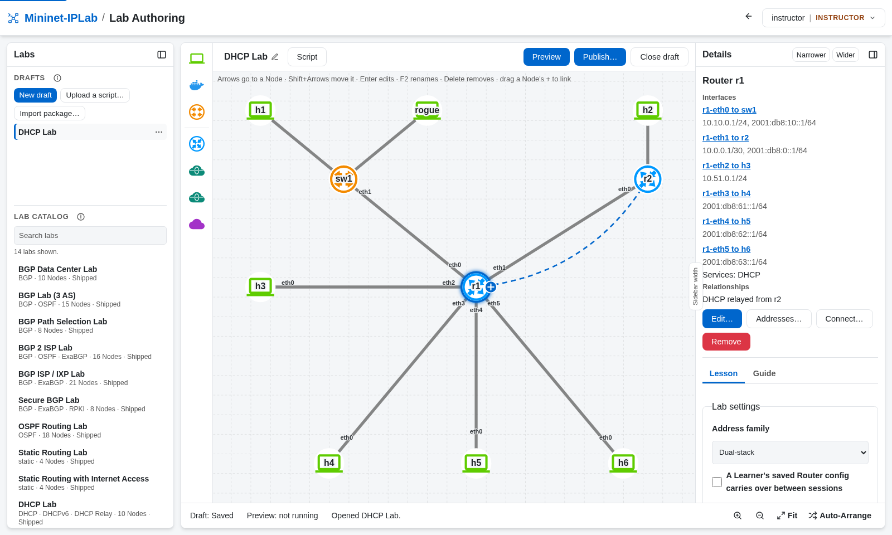
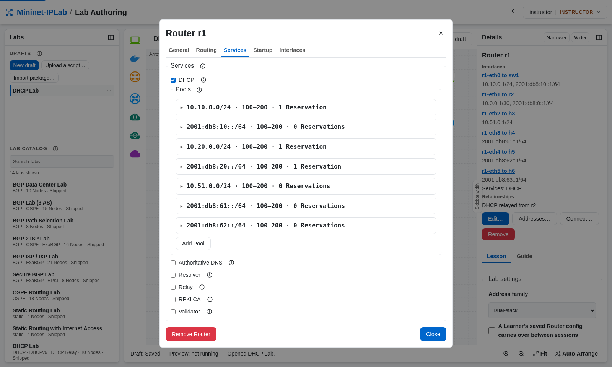
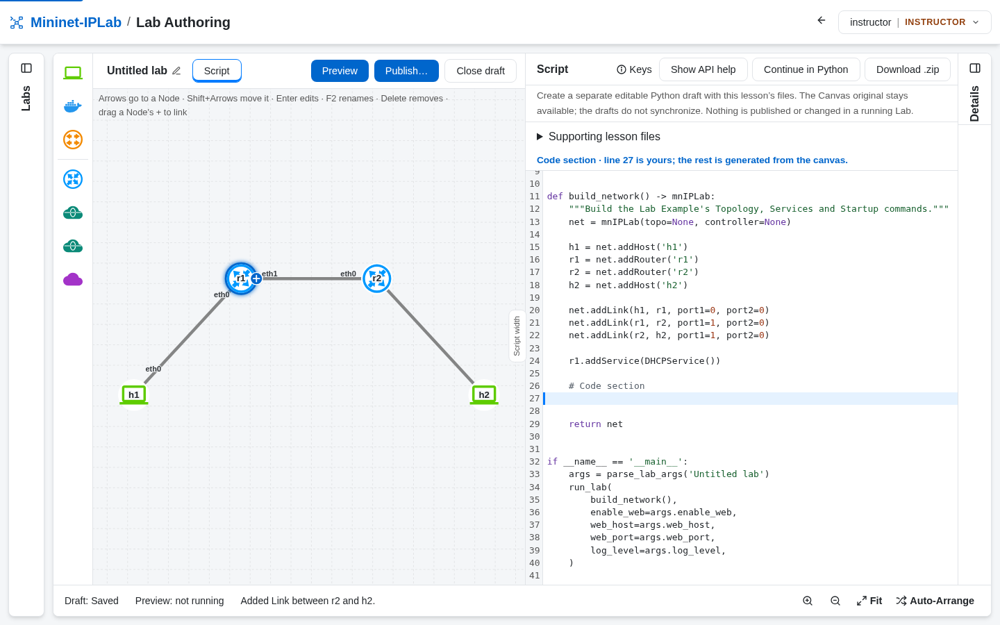

Lab Authoring is the browser path to a new Lab Example. An Instructor draws the Topology on a canvas, configures
Routers and Services in dialogs, tries the result in a Preview Lab, and publishes it into the Lab Catalog, without
writing the Python by hand. Use it to create a Lab Example beyond the shipped ones, adapt a shipped one, or revise one
you published. To write the script yourself instead, follow [How to create a Lab](/docs/build-labs/).

<p></p>

## Where it runs

Lab Authoring is used on the classroom server, `python -m mniplab serve`, in Single-Lab or Multi-Lab Mode. Sign in as
an Instructor and choose **Lab Authoring** in the header. Learners cannot open drafts or an Instructor's Preview Lab.
Under `python3 my-lab.py --enable-web` the launched Lab is already running, so Preview and Publish are refused.

Drafts and published Lab Examples are kept in `authored-labs/` in the core checkout, or wherever
`MNIPLAB_AUTHORED_LABS_DIR` points.

## Create a draft

The **Labs** explorer beside the canvas holds the shared Instructor draft library above the **Lab Catalog**:

- **New draft** starts an empty Canvas draft. A draft's name is its Catalog name; its **⋯** menu offers **Rename**,
  **Copy as new**, and **Delete**.
- **Copy** on a shipped Lab Example in the Lab Catalog creates an independent Python draft from its exact script and
  files, including its FRR Seeds, Guide, and Layout. **Start from Canvas version** opens its prepared Canvas
  definition instead.
- **Upload a script…** creates a Python draft from one `.py` file of at most 500,000 bytes. Add imported helpers,
  data, or FRR Seeds in **Supporting lesson files**, or import a complete package.
- **Import package…** restores a **Download .zip** export as a new unpublished draft.

A Canvas draft can become Python with **Script → Continue in Python**, which creates a separate Python draft; the two
do not synchronize.

## Draw the Lab



The palette offers Host, Container Host, Switch, Router, Internet Gateway, Transit Internet Gateway, and BGP Speaker.
Drag an item onto the canvas, or activate its button to place it at a free spot. To connect two Nodes, drag a Node's
**+** onto another, or choose **Connect…** in the Selection panel; each Link gets the next free Interface at both ends.
Choose **Edit…** or press Enter to set addresses, VLANs, Link Conditions, FRR configuration, Startup commands, and
Services. The canvas is fully keyboard operable: arrows move focus between Nodes and Shift+Arrow moves a Node.

Enable a Service in a Node's Services checklist to open its structured editor: DHCP Pools and Reservations, a Relay,
Primary and Secondary Zones, a Resolver with DNSSEC, a BGP Speaker's Neighbors and Routes, or an RPKI CA and
Validator.



The **Details** sidebar's **Lesson** tab holds the Catalog name, description, Area, and address family, and
its **Guide** tab is a Markdown editor for the Guide Learners will read.

The **Script** pane shows the Python generated from the canvas. Only its **Code section** takes typing: Python for
what the canvas cannot draw, such as a loop of Routers or a helper, run inside `build_network()` with `net` and each
Node by its name. It is kept exactly as written when the canvas regenerates the script.



## Preview and keep changes

**Preview** saves pending edits and starts an isolated Lab from the saved recipe. Use **Open Lab** for the running
page with its Terminals, Tools, and Service panels. A Preview counts toward the normal Lab cap; in Single-Lab Mode
another shared Lab must stop first.

Configure the running Preview as you would any Lab, for example in `vtysh`, then choose **Keep changes…**. It compares
supported configuration with the Preview's starting snapshot, one row per Node or Service, and nothing is kept unless
you tick it. Keep supports a Router's running FRR configuration (chosen by whole FRR section), switch port VLANs,
unambiguous Link Conditions, DHCP Pools and Reservations, Primary Zone Records, Resolver Access Control, and each Hosted
CA's ROAs and ASPAs. Learned routes, Leases, caches, Secondary replicas, and DNSSEC keys are never kept.

## Publish and assign

**Publish…** lists any unmet requirement with its fix, such as a missing Catalog name or Area. Without a successful
Preview of the current draft it starts its own check Lab and publishes once startup succeeds; a failed start publishes
nothing. Startup success is the gate, so checking routing and connectivity stays the Instructor's job.

Publishing creates a new immutable Catalog version. A draft of an authored Lab Example can **Publish as new** or
**Update existing** under its Catalog ID; running Labs keep their version while new starts get the new one.

- In Single-Lab Mode, start the published Lab Example from the Lab Catalog in the **Labs** sidebar.
- In [Multi-Lab Mode](/docs/features/multi-lab/), add it to a Group with **Assign…** in the Class Overview.

**Revise** on an authored Catalog entry opens its latest version, and **Remove from Catalog** undoes a publication,
refused while any Lab of it runs. A Group's [Persistent Config](/docs/build-labs/persistent-config/) copy resumes across
compatible revisions; a structural change, such as a renamed Router, makes it incompatible and the Group starts clean.

## Export and run it elsewhere

**Download .zip** exports the complete native package and a runnable folder: the script, Router Seeds under
`frr-config/`, the Guide and Layout under `examples/`, and a README. Run it as root with `mniplab` importable:

```bash
cd routed-lab
PYTHONPATH=/path/to/mininet-iplab python3 routed-lab.py --enable-web
```

The Lab needs Mininet and FRR, plus what its Nodes use: Open vSwitch for Switches, Docker for Container Hosts, ExaBGP
for Speakers, Kea for DHCP, Knot for DNS, and Unbound for a Resolver. The full walkthrough, including keyboard
operation and package limits, is the core
[`lab-authoring.md`](https://github.com/mininet-iplab/mininet-iplab/blob/v0.1.0/docs/lab-authoring.md).
