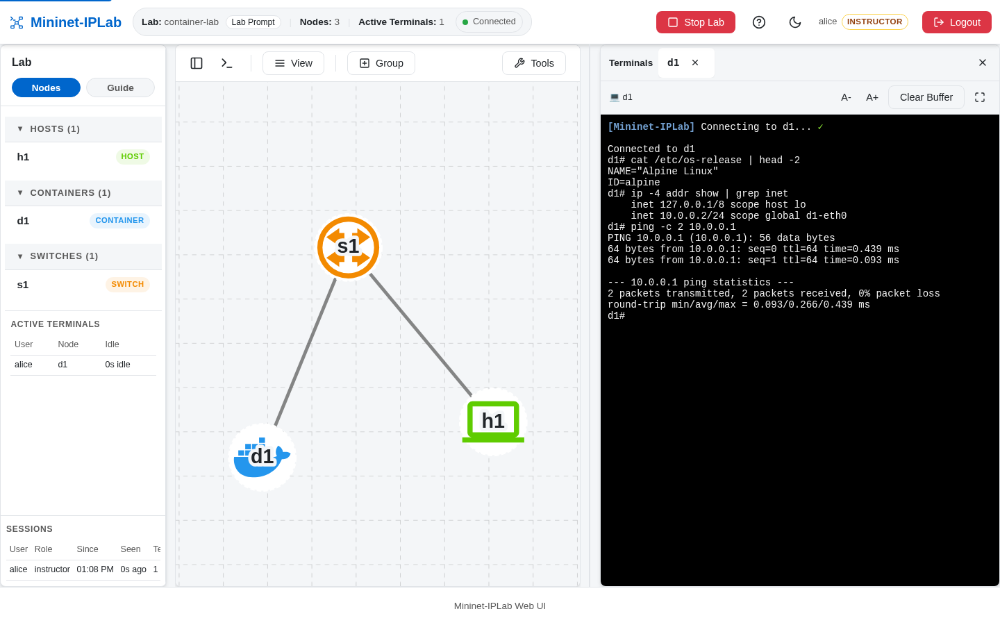

A Container Host is a Lab Node whose processes come from a Docker image rather than a bare network namespace. Use it
when the lesson needs real application software, such as a web server, a database, or a client stack.

## Add it to a Lab

Add one with `addContainer`; `dimage` is required. Its addresses go on its Link ends, like any other Node's:

```python
net = mnIPLab(topo=None, autoSetMacs=True, controller=None)

h1 = net.addHost('h1')
d1 = net.addContainer('d1', dimage='nginx:1.27', dcmd='nginx -g "daemon off;"')
s1 = net.addSwitch('s1')
net.addLink(h1, s1, params1={'ip': '10.0.0.1/24'})
net.addLink(s1, d1, params2={'ip': '10.0.0.2/24'})
```

- **The image's own command is not run.** Pass `dcmd='...'` to start the software you want on the network. Without
  it the container runs a sleep loop, kept alive so a Terminal can be opened on it.
- `environment`, `volumes`, `ports`, `port_bindings`, and `cap_add` (default `NET_ADMIN`) pass through to
  `docker run`. The Lab's shared `/etc/hosts` is mounted by default.
- `defaultRoute` and `defaultRoute6` work as on `addHost`.
- A Docker daemon must be reachable from wherever the Lab runs; the core dev container ships docker-in-docker for
  this. Like every switch, `s1` needs the Open vSwitch kernel module on the host.

## Verify it

From the Lab Prompt, reach the Container Host from `h1`:

```bash
h1 ping -c 3 10.0.0.2
h1 curl -s http://10.0.0.2/
```

In Web UI Mode a Container Host is drawn distinctly from a Host, and its Terminal runs `docker exec` into the
container rather than entering a bare network namespace.



No shipped Lab Example uses a Container Host in `v0.1.0`. Use the declaration above in your own `build_network()` with
`run_lab`; the core [`CREATE_LAB.md`](https://github.com/mininet-iplab/mininet-iplab/blob/v0.1.0/docs/CREATE_LAB.md#container-hosts)
has the full parameter list.
