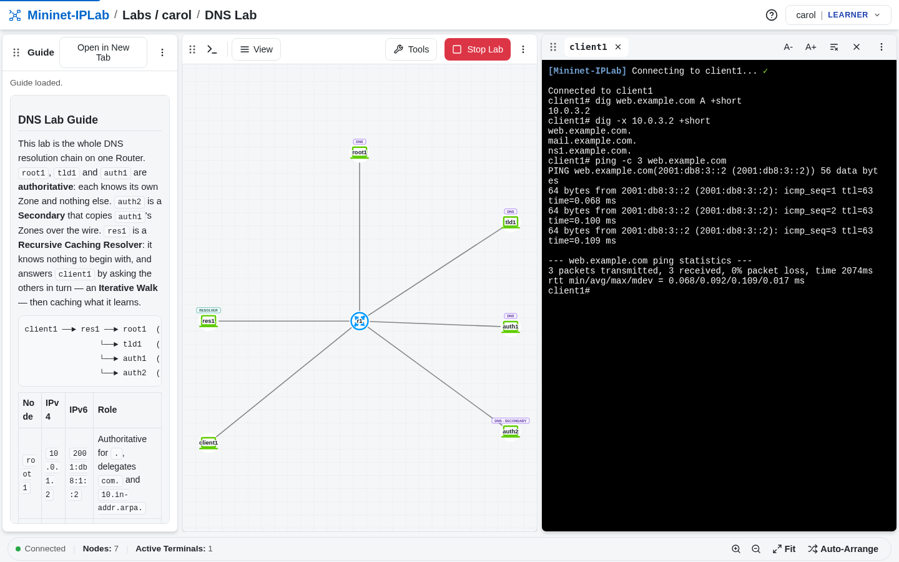
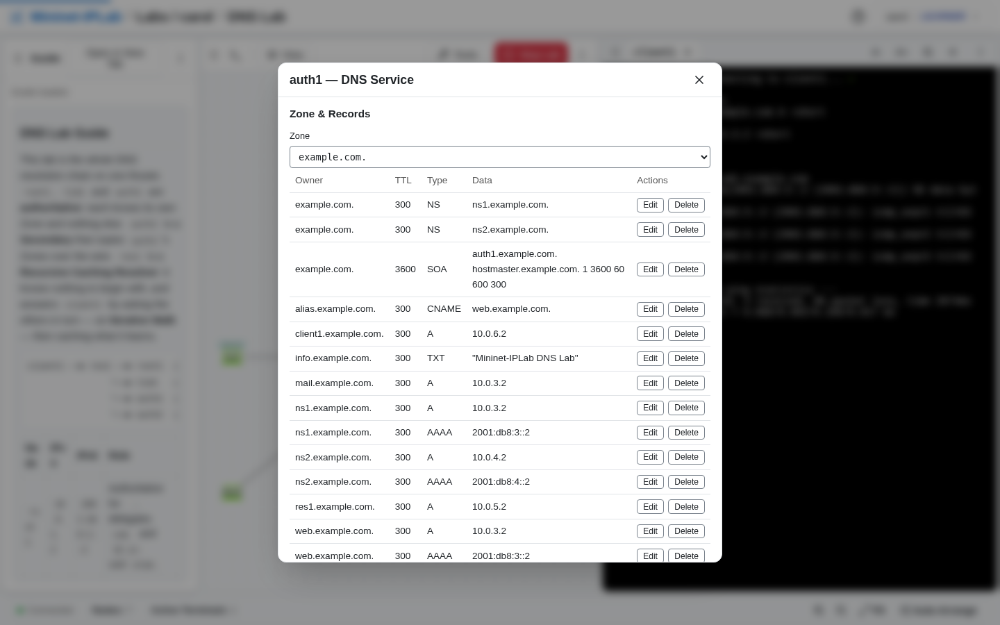

DNS is added as a Service on an existing Node. An authoritative Service, backed by Knot DNS, hosts one or more
Zones and answers for them.

## Add it to a Lab

Create a DNS Host and attach a Zone. Like every Interface address, the Host's `10.0.0.2/24` goes on its Link end:

```python
from mniplab.dns import ARecord, CNAMERecord, DNSService, Zone

dns1 = net.addHost('dns1', defaultRoute='via 10.0.0.1')
net.addLink(dns1, r1, params1={'ip': '10.0.0.2/24'}, params2={'ip': '10.0.0.1/24'})
dns1.addService(DNSService(Zone(
    'example.com.',
    [
        ARecord('web', '10.0.2.2'),
        CNAMERecord('alias', 'web.example.com.'),
    ],
    host_node='dns1',
)))
```

Point client Hosts at that Node with `nameservers`:

```python
h1 = net.addHost('h1', defaultRoute='via 10.0.1.1', nameservers=['10.0.0.2'])
```

The `nameservers` setting gives the emulated Host a private `/etc/resolv.conf` in its own mount namespace, so `ping`,
`curl`, and `dig` on that Host resolve against the Lab and the machine running the Lab is untouched.

Record types are `ARecord`, `AAAARecord`, `CNAMERecord`, `PTRRecord`, `TXTRecord`, `MXRecord`, `NSRecord`,
`SOARecord`, and `DSRecord`. Each takes an owner name relative to the apex (`'@'` for the apex itself) and an optional
`ttl` (default 300). SOA and apex NS Records are generated when omitted. A Zone's apex is Lab shape the Instructor
declares; the Records within it are Exercise Configuration a Learner edits, discarded when the Lab stops.

To give clients a caching Resolver that walks the hierarchy instead, see
[Recursive Resolver](/docs/features/dns-resolver/). To replicate a Zone to a second nameserver, see
[Secondary nameserver](/docs/features/dns-secondary/).

## Verify it

From a client Terminal:

```bash
dig web.example.com
ping web.example.com
```



Inspect a Service with `show_dns dns1` and `show_dns_records dns1 example.com.` at the Lab Prompt, or add a Record
with `dns_records dns1 example.com. add <owner> <type> <data...>`. In Web UI Mode select the `DNS` badge on `dns1`.
The DNS panel lists the Zone's Records and lets a Learner add, edit, or delete them; every change is one Knot
transaction, so a Zone is never served half-edited and a rejected change leaves it intact. **Live Query Activity**
counts queries by type and response code as clients ask.



[`dns-lab.py`](https://github.com/mininet-iplab/mininet-iplab/blob/v0.1.0/examples/dns-lab.py) puts the whole
resolution chain on one Router: a Root, a TLD, a Primary and a Secondary for `example.com.` and its reverse Zone, a
Recursive Caching Resolver, and `client1`, each on its own Subnet. The full reference is the core
[`DNS.md`](https://github.com/mininet-iplab/mininet-iplab/blob/v0.1.0/docs/DNS.md).
