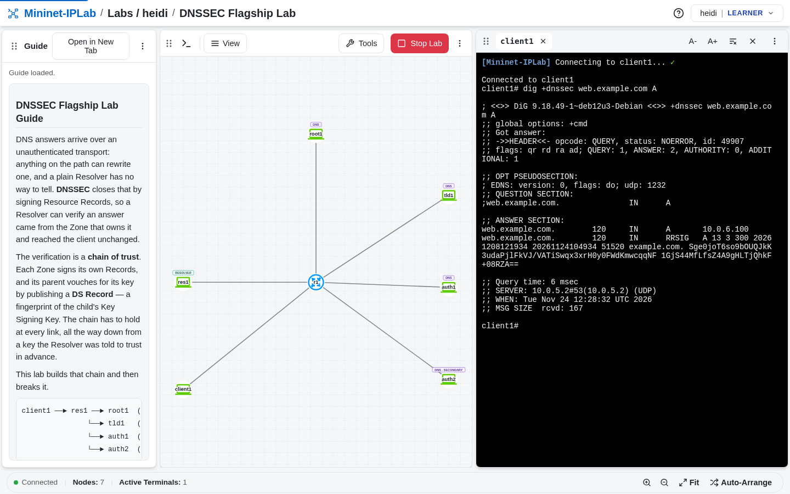
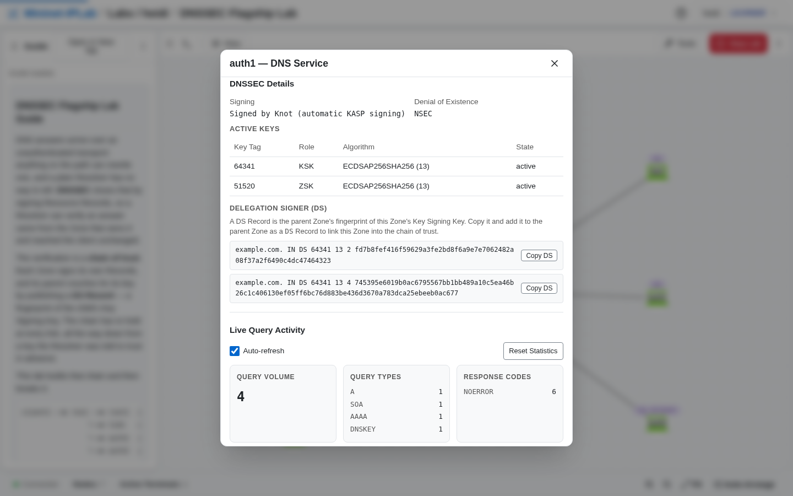

DNSSEC has two sides: a Primary Zone signs records, and a Resolver validates the chain using a Trust Anchor. A signed
Zone by itself does not prove that a client is validating responses.

## Add it to a Lab

Mark the authoritative Zone as signed:

```python
from mniplab.dns import ARecord, DNSService, Zone

example_zone = Zone(
    'example.com.',
    [
        ARecord('web', '10.0.6.100'),
        ARecord('mail', '10.0.3.2'),
    ],
    host_node='auth1',
    dnssec=True,
)
auth1.addService(DNSService(example_zone))
```

Attach a validating Resolver and give it the Root Host as a Trust Anchor:

```python
from mniplab.resolver import ResolverService

res1.addService(ResolverService(
    root_hints=[root1],
    trust_anchors=[root1],
))
```

`dnssec=True` makes Knot's KASP engine generate a split KSK/ZSK pair (ECDSA P-256, algorithm 13) and sign the Zone at
Lab build time. Non-existence is proved with NSEC by default; pass `nsec3=True` (and optionally `nsec3_salt`) to hash
the names instead.

Because the keys exist at build time, the parent Zone can publish the child's DS straight from it:

```python
com_zone = Zone('com.', [
    NSRecord('@', 'ns.com.'),
    ARecord('ns', '10.0.2.2'),
    NSRecord('example', 'ns1.example.com.'),
    ARecord('ns1.example.com.', '10.0.3.2'),
    example_zone.ds_record(),   # the delegation the chain of trust hangs on
], host_node='tld1', dnssec=True)
```

A DS is Exercise Configuration: a Learner edits it in the parent Zone to break the chain and again to repair it. A DS
that does not match the child's key at start is a warning, not an error, because the broken delegation is a lesson. A
Trust Anchor may be a Node hosting a signed Zone, a `Zone`, a `DSRecord`, or a raw RR string. An answer whose chain
does not hold is answered `SERVFAIL` and not cached; an unsigned Zone beneath the anchor is `INSECURE`, not bogus.

## Verify it

From the client Host, ask for DNSSEC data and check the authenticated-data flag:

```bash
dig +dnssec web.example.com @10.0.5.2
delv web.example.com @10.0.5.2
```

A validated answer carries the `ad` (authenticated data) flag and an `RRSIG` beside the `A` record:



Select the `DNS` badge on `auth1` to see the signed Zone. The panel marks it **Signed**, can reveal the `RRSIG` and
`NSEC` Records the editor otherwise hides, and its **DNSSEC Details** section lists the active keys and the `DS`
records the parent Zone must publish, each with a **Copy DS** button. At the Lab Prompt, `dnssec_keys auth1
example.com.` lists the same. Run `dnssec_rollover auth1 example.com. zsk` to roll the Zone Signing Key while clients
keep validating; a `ksk` rollover changes the DS the parent must publish. On the Resolver, the
[Cache Inspector](/docs/features/dns-resolver/) shows each cached answer as `SECURE`, `BOGUS`, or `INSECURE`.



The source-backed [`dnssec-lab.py`](https://github.com/mininet-iplab/mininet-iplab/blob/v0.1.0/examples/dnssec-lab.py)
contains the full signed Root → TLD → Authoritative hierarchy with a Secondary and a validating Resolver; its
[Guide](https://github.com/mininet-iplab/mininet-iplab/blob/v0.1.0/examples/guides/dnssec-lab.md) breaks and repairs the
chain of trust and rolls keys. The broader DNS Service reference is in
[`DNS.md`](https://github.com/mininet-iplab/mininet-iplab/blob/v0.1.0/docs/DNS.md).
