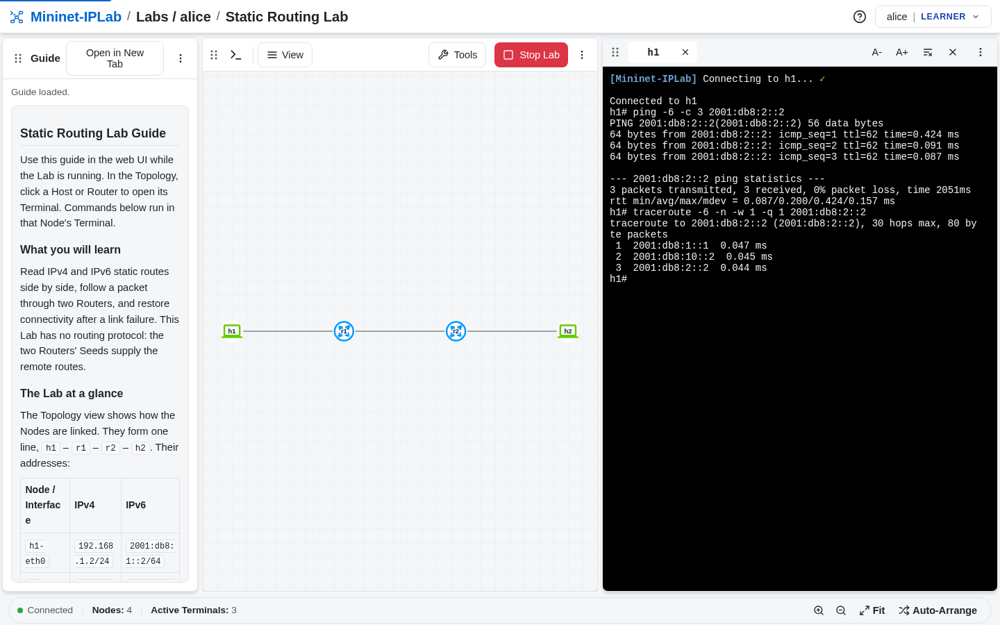

IPv6 is added explicitly. An IPv4 address does not create an IPv6 address or route. Every IPv6 Interface address is an
`ip6` on a Link end, a Host's included; the Host itself carries only its gateway, `defaultRoute6`.

## Add it to a Lab

Give Hosts an IPv6 default gateway, and put the IPv6 addresses on both ends of each Link:

```python
h1 = net.addHost('h1', defaultRoute6='via 2001:db8:1::1')
h2 = net.addHost('h2', defaultRoute6='via 2001:db8:2::1')

net.addLink(h1, r1, params1={'ip6': '2001:db8:1::2/64'}, params2={'ip6': '2001:db8:1::1/64'})
net.addLink(h2, r2, params1={'ip6': '2001:db8:2::2/64'}, params2={'ip6': '2001:db8:2::1/64'})
net.addLink(r1, r2,
            params1={'ip6': '2001:db8:ff::1/64'},
            params2={'ip6': '2001:db8:ff::2/64'})
```

For a dual-stack Link, give each end both `ip` and `ip6`, and the Host both `defaultRoute` and `defaultRoute6`. Each
family has one key: an IPv6 value under `ip`, or an IPv4 gateway under `defaultRoute6`, is refused with the right key
named. A link-local gateway such as `defaultRoute6='via fe80::1'` works too, because the route is installed naming its
device.

For an IPv6 static-routing lesson, add IPv6 routes on the Routers. For OSPFv3 use `proto='OSPF6'` with
`ipv6 ospf6 area 0` on each Interface, and for BGP add the IPv6 unicast address family. OSPFv3 waits for its
Designated Router like OSPFv2: allow about 50 seconds with default timers before testing.

IPv6 addresses are applied without Duplicate Address Detection (`nodad`) by default to speed up start. Pass
`dad_mode='strict'` on a Link, or set `MNIPLAB_IPV6_DAD_MODE=strict`, when DAD is part of the lesson.

## Verify it

Use IPv6 commands when testing the IPv6 path:

```bash
ping -6 -c 3 2001:db8:2::2
r1 ip -6 route
r1 vtysh -c 'show ipv6 route'
```



[`static-lab.py`](https://github.com/mininet-iplab/mininet-iplab/blob/v0.1.0/examples/static-lab.py) is dual-stack:
its [Guide](https://github.com/mininet-iplab/mininet-iplab/blob/v0.1.0/examples/guides/static-lab.md) teaches IPv4 and
IPv6 static routes side by side, so compare the two route tables and the `ping` and `ping -6` results. Most other Lab
Examples, including `dns-lab`, `dhcp-lab`, and `nat-lab`, are dual-stack as well.
