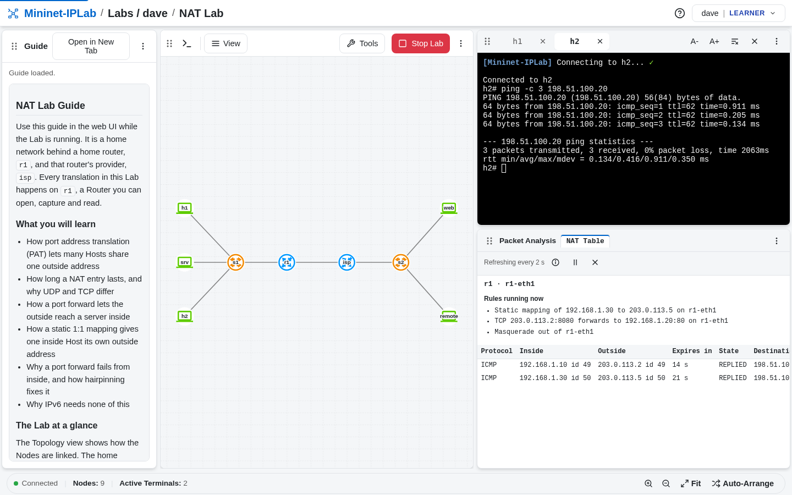

NAT appears in a Lab in two different roles:

- **Router NAT** is the translation the Lab teaches. A Router declared with `nat=[...]` masquerades traffic leaving its
  outside Interface, and can also forward ports or map one inside address to one outside address. The
  [NAT Lab](/docs/lab-examples/#nat-lab) is built around it.
- **An Internet Gateway** connects a Lab to the real Internet through the host machine. `addNAT()` adds one; the
  Router linked to it translates the Lab's traffic. The translation to the host's uplink is plumbing, not a lesson.

## Add it to a Lab

### Router NAT

Declare the entries on the Router and mark its outside Interface on the Link end with `'nat': 'outside'`:

```python
from mniplab import PortForward, StaticNAT

r1 = net.addRouter('r1', nat=[
    PortForward('tcp', 8080, '192.168.1.20', 80),
    StaticNAT('192.168.1.30', '203.0.113.5'),
])
isp = net.addRouter('isp')
net.addLink(r1, isp,
            params1={'ip': '203.0.113.2/30', 'nat': 'outside'},
            params2={'ip': '203.0.113.1/30'})
```

- Every outside Interface masquerades the traffic that leaves through it, so the inside Hosts share one outside
  address (PAT).
- `PortForward(protocol, outside_port, inside, inside_port, hairpin=False, interface=None)` forwards a TCP or UDP port
  on the outside address to an inside Host. `hairpin=True` also lets inside clients reach it through the outside
  address.
- `StaticNAT(inside, outside, interface=None)` maps one inside address to one outside address in both directions. The
  upstream Router must route `outside` toward the outside Interface.
- Both entries are IPv4. Pass `interface='r1-eth1'` only when the Router has more than one outside Interface.

The rules are rendered as iptables rules in the Router's own namespace at start, and nothing is written on the host.
Mistakes such as an entry on a Router with no outside Interface stop the Lab before any Node starts, with the Router
and Interface named.

### An Internet Gateway

Create the Gateway and link it to one Router yourself. Unlike Mininet's built-in `addNAT()`, Mininet-IPLab's takes no
`connect=` and attaches to nothing by itself. Its address goes on its Link end, like any other Interface's, and
`subnet` is metadata only:

```python
nat1 = net.addNAT('nat1', subnet='100.64.0.0/23')
r1 = net.addRouter('r1')
net.addLink(nat1, r1, params1={'ip': '100.64.0.1/24'}, params2={'ip': '100.64.0.2/24'})
```

The Router then translates the Lab's traffic toward the Gateway. A Learner's Topology draws the Gateway as the
Internet cloud; the CLI's Node list leaves it out. Internet Gateways are IPv4 only. For an ISP path through an ExaBGP
Speaker, `net.addTransit('nat1', downstream=isp1, subnet='192.168.0.0/30')` adds a Transit Internet Gateway: the
Speaker sits between it and `isp1`, and the downstream Router translates.

The smallest complete example is [`static-lab-nat.py`](https://github.com/mininet-iplab/mininet-iplab/blob/v0.1.0/examples/static-lab-nat.py);
[`bgp-isp-lab.py`](https://github.com/mininet-iplab/mininet-iplab/blob/v0.1.0/examples/bgp-isp-lab.py) gives each of
two ISPs its own Transit Internet Gateway.

## Verify it

In Web UI Mode, send traffic from an inside Host across the translating Router, then click that Router and choose
**NAT Table**. The item appears only on a Router with Router NAT. The table opens in Packet Analysis, does not count
against the limit of two Captures, and refreshes every two seconds. Each row is one translated connection: its
protocol, the **inside** address and port it came from, the **outside** address and port the Router substituted (for
ICMP, the echo identifier takes the port's place), how long the entry has left, its state, and its destination.



Only translated connections appear, and only the Lab's own Routers: an Internet Gateway's translation to the host's
uplink and another Lab's entries never do. Capture the Router's Interfaces on both sides to see the source address
change. The [NAT Lab Guide](https://github.com/mininet-iplab/mininet-iplab/blob/v0.1.0/examples/guides/nat-lab.md)
walks through PAT, entry timeouts, a port forward, static 1:1 NAT, hairpinning, and why IPv6 needs none of it.
