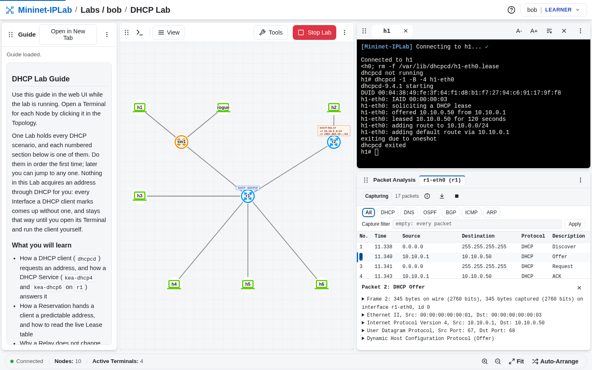
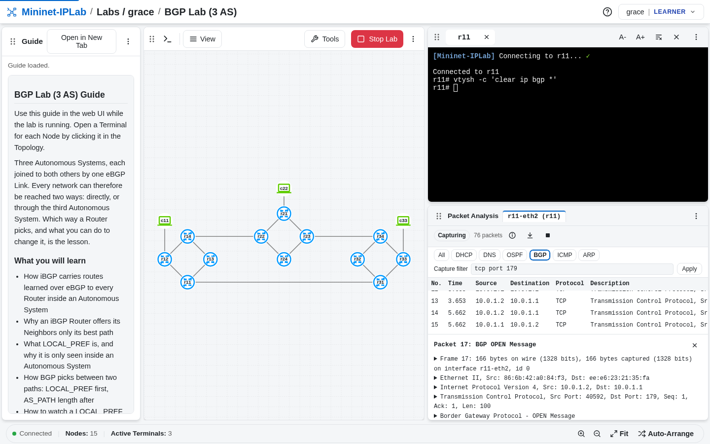

Packet Capture observes one Interface of a running Lab. It helps connect a command in a Node Terminal to the
protocol messages seen on the wire. A capture does not change the Topology or routing configuration.

## Add it to a Lab

Start a Lab Example in Web UI Mode, for example `python3 examples/dhcp-lab.py --enable-web`. Click a Link, Router,
Host, or Speaker and choose **Packet Capture**. Then choose the Interface to watch: each button names its Interface,
because the same packet differs on either side of a Router. A Node's menu lists every Interface it has, including one
whose Link is not drawn. Switch ports, Container Hosts, and Internet Gateways cannot be captured, so a capture only
ever shows its own Lab's traffic.

Select a protocol preset such as DHCP, DNS, OSPF, BGP, ICMP, or ARP, or enter a BPF capture filter such as
`host 10.0.0.1 and icmp`. Changing the filter starts a new capture. Open a packet row to inspect its decoded fields;
use **Download pcap** to analyze the full capture outside the browser. Wireshark display filters are not accepted;
download the pcap for those. At most two captures can run at once, so you can compare packets on either side of a
Router: the TTL falls by one and, across a NAT Router, the source address is rewritten.

A capture is shared: everyone watching the same Interface sees one capture, and a reloaded page reopens it. Above 200
packets a second only summary rows are sent, and the list keeps the latest 1000 packets; the pcap keeps them all.

## Verify it

Capture a Host or Router Interface, then send `ping -c 3 <peer-address>` from a Node Terminal. The capture should
show ICMP Echo requests and replies. Select a row to inspect its fields and download the pcap before stopping the
Lab; capture files are removed when the Lab stops. For a guided protocol example, follow the
[BGP Packet Analysis exercise](https://github.com/mininet-iplab/mininet-iplab/blob/v0.1.0/examples/guides/bgp-isp-lab.md#packet-analysis)
in the BGP 2 ISP Lab.

The [core Web UI guide](https://github.com/mininet-iplab/mininet-iplab/blob/v0.1.0/docs/web-ui.md#packet-capture)
documents filters, capture limits, and pcap retention.
