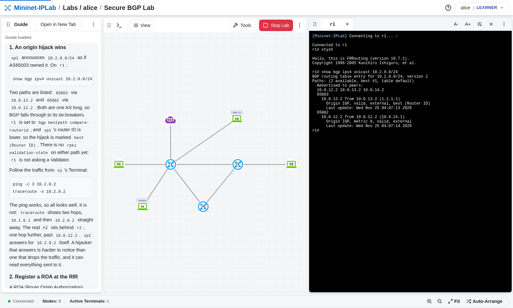
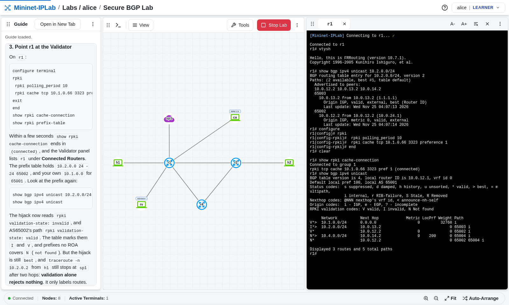
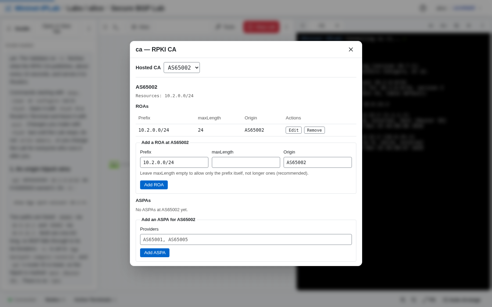
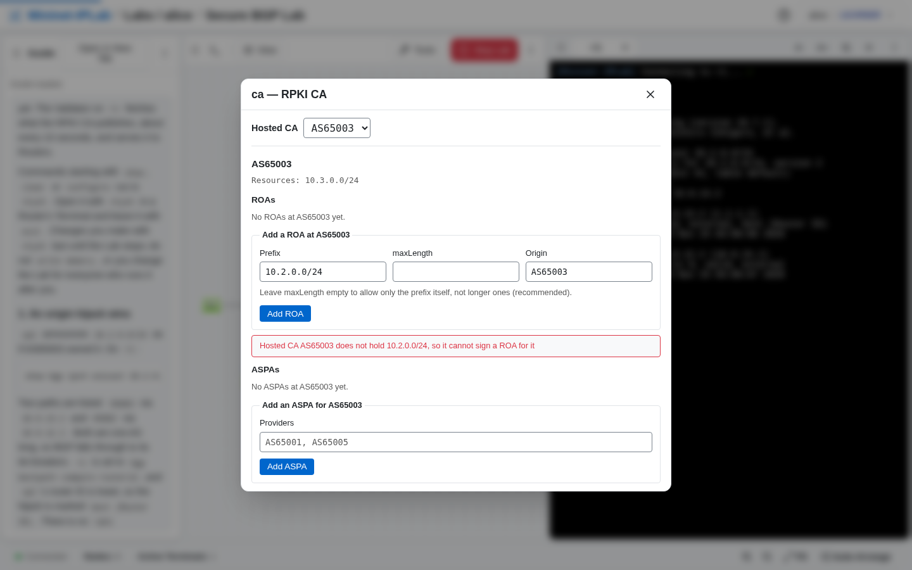
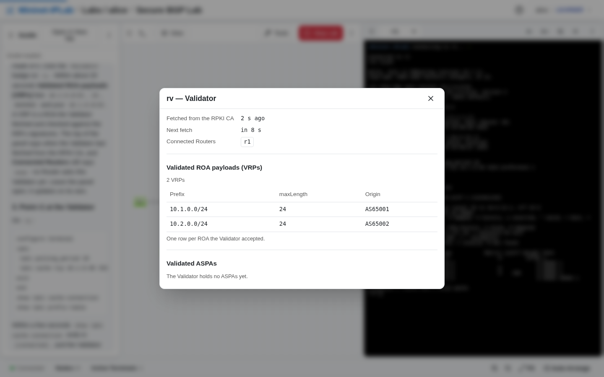

The Resource Public Key Infrastructure lets an Autonomous System sign which origin AS may announce its prefixes. Two
Services bring it into a Lab:

- **RPKI CA** (`RPKICAService`), backed by [Krill](https://nlnetlabs.nl/projects/routing/krill/), signs RPKI objects on
  behalf of the Lab's Autonomous Systems, as an RIR's hosted portal does. It holds one **Hosted CA** per Autonomous
  System, and each Hosted CA can sign ROAs and ASPAs only for the ASN and prefixes the Lab gives it.
- **Validator** (`ValidatorService`), backed by [Routinator](https://nlnetlabs.nl/projects/routing/routinator/), fetches
  what the RPKI CA signs, validates it, and serves the result to Routers over RTR as VRPs (Validated ROA Payloads).

Routers then do **Route Origin Validation** in FRR: they mark each BGP path `valid`, `invalid`, or `not found` and,
with a route-map, deny the invalid ones. Like every Service, both attach to any Host or Router.



## Add it to a Lab

Declare the RPKI CA with its Hosted CAs, and a Validator on another Node. Both Nodes need a route to each other:

```python
from mniplab.rpki import HostedCA, RPKICAService, ValidatorService

ca = net.addHost('ca', defaultRoute='via 10.99.0.1')
ca.addService(RPKICAService([
    HostedCA(65001, ['10.1.0.0/24']),
    HostedCA(65002, ['10.2.0.0/24'], roas=['10.2.0.0/24 => 65002']),
    HostedCA(65004, ['10.4.0.0/24'], aspas=['AS65004 => AS65001, AS65002']),
]))

rv = net.addHost('rv', defaultRoute='via 10.1.0.65')
rv.addService(ValidatorService())          # or ValidatorService(refresh=30)
```

- `HostedCA(asn, prefixes, roas=(), aspas=())` takes the ASN (an int or text such as `AS65002`) and at least one IPv4
  or IPv6 prefix. Starting ROAs are written as Krill writes them, `<prefix>[-<maxLength>] => <origin>`, and must fall
  inside the Hosted CA's prefixes; the maxLength defaults to the prefix length. Starting ASPAs are
  `<customer> => <provider>[, <provider>...]`, with the Hosted CA's own ASN as the customer.
- A Lab holds at most one RPKI CA, and a Validator needs one. Both listen on IPv4 only, though ROAs may cover IPv6
  prefixes.
- The Validator takes its TAL and trust from the Lab's RPKI CA, serves RTR on TCP port **3323**, and validates again
  every `refresh` seconds (10 by default).

Nothing in a Router's configuration changes on its own. Point each validating Router at the Validator in FRR, and put
a deny ahead of the permit entries of each inbound route-map so invalid paths are rejected:

```text
rpki
 rpki polling_period 10
 rpki cache tcp 10.1.0.66 3323 preference 1
exit
route-map FROM-PEER deny 5
 match rpki invalid
exit
```



Validation alone rejects nothing. FRR re-marks a path within seconds of a VRP change but does not re-run inbound
route-maps, so after a ROA change re-apply the policy with `clear bgp ipv4 unicast * soft in` (the neighbor needs
`soft-reconfiguration inbound`).

### Route leaks and BGP Roles

Route Origin Validation cannot see a route leak, because the origin is still right. FRR does not act on ASPAs yet, so
the Secure BGP Lab stops leaks with BGP Roles (RFC 9234): each provider declares its relationship, and a route a
customer leaks back carries the Only to Customer attribute and is dropped:

```text
router bgp 65001
 neighbor 10.0.14.2 local-role provider
exit
```

Roles take effect only after the BGP session resets, for example with `clear bgp 10.0.14.2`.

## Verify it

On a Router pointed at the Validator, `show rpki cache-connection` ends in `(connected)` within a few seconds and
`show rpki prefix-table` lists the VRPs. `show bgp ipv4 unicast` then marks paths `V` (valid), `I` (invalid), and
`N` (not found).

In Web UI Mode the RPKI CA and the Validator carry `RPKI CA` and `Validator` badges. The **RPKI CA** panel shows one
Hosted CA at a time with its Resources, ROAs, and ASPAs, and signs, edits, or withdraws them; a ROA for a prefix the
Hosted CA does not hold is refused with the reason.





The read-only **Validator** panel lists the VRPs and ASPAs it
serves, when it last fetched and fetches next, and the Routers connected over RTR. A new ROA reaches the Validator on
its next run, about 20 seconds with the default `refresh`.



At the Lab Prompt use `show_rpki ca`, `rpki_roas ca 65002 add 10.2.0.0/24 => 65002`, `rpki_aspas ...`, and
`show_vrps rv`. In a Terminal on the RPKI CA's Node, `krillc roas list --ca as65002` talks to Krill directly, and its
changes show in the panel too. ROAs and ASPAs changed while the Lab runs are Exercise Configuration, discarded when the
Lab stops.

[`secure-bgp-lab.py`](https://github.com/mininet-iplab/mininet-iplab/blob/v0.1.0/examples/secure-bgp-lab.py) and its
[Guide](https://github.com/mininet-iplab/mininet-iplab/blob/v0.1.0/examples/guides/secure-bgp-lab.md) walk through an
origin hijack, registering a ROA, pointing a Router at the Validator, denying invalid routes, a forged origin through a
loose maxLength, and a route leak stopped with BGP Roles. The full reference is the core
[`RPKI.md`](https://github.com/mininet-iplab/mininet-iplab/blob/v0.1.0/docs/RPKI.md).
