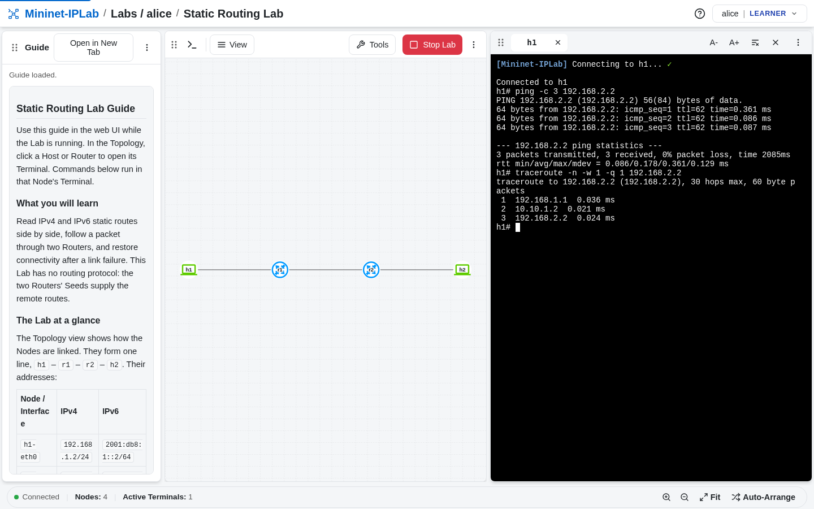

Static routing is the smallest routing feature: create the Nodes and Links, then add a route for each remote network.
The route belongs in the Lab Example, not in the learner's terminal.

## Add it to a Lab

Give each Router its static routes in FRR's syntax with `frr_config` when you add it:

```python
r1 = net.addRouter('r1', frr_config='ip route 192.168.2.0/24 10.10.1.2\n')
r2 = net.addRouter('r2', frr_config='ip route 192.168.1.0/24 10.10.1.1\n')
```

For a dual-stack Lab add the IPv6 routes the same way, such as `ipv6 route 2001:db8:2::/64 2001:db8:10::2`. A Router
with [Persistent Config](/docs/build-labs/persistent-config/) keeps these lines in its seed `frr.conf` instead, which
is how `static-lab` ships them.

The surrounding topology needs these addresses:

```python
net.addLink(r1, r2,
            params1={'ip': '10.10.1.1/30'},
            params2={'ip': '10.10.1.2/30'})
```

Use one route in each direction. A directly connected interface is not enough to reach the other Host's network.

## Verify it

Run the Lab, then inspect both route tables and test the path:

```bash
r1 vtysh -c 'show ip route 192.168.2.0/24'
r2 vtysh -c 'show ip route 192.168.1.0/24'
h1 ping -c 3 192.168.2.2
```



The route should show as static (`S`) and the ping should cross `h1 → r1 → r2 → h2`. For the complete runnable,
dual-stack topology, use the [`static-lab.py` source](https://github.com/mininet-iplab/mininet-iplab/blob/v0.1.0/examples/static-lab.py)
and its [`frr-config`](https://github.com/mininet-iplab/mininet-iplab/tree/v0.1.0/frr-config/static-lab)
directory. [`static-lab-nat.py`](https://github.com/mininet-iplab/mininet-iplab/blob/v0.1.0/examples/static-lab-nat.py)
adds a default route to the real Internet through an [Internet Gateway](/docs/features/nat/).

For the conceptual difference between a configured route and a Link Condition, change one existing Link in Web UI Mode
and compare the result with the route table above.
