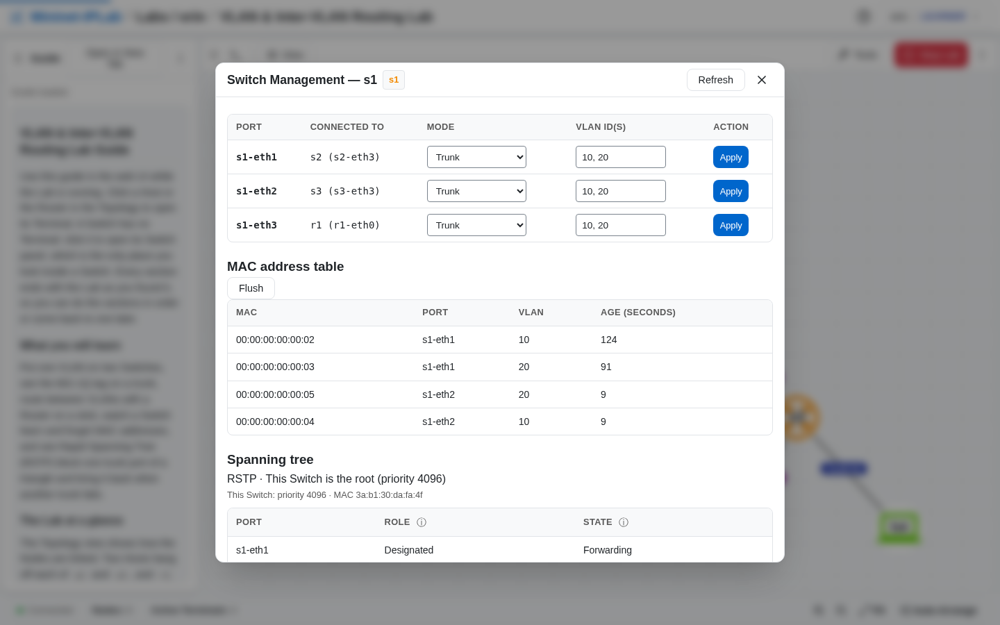

A VLAN assigns switch ports to separate Layer 2 segments. To let Hosts in different VLANs communicate, connect a
Router to a trunk port and give it one addressed sub-interface per VLAN (router-on-a-stick). Each Host needs a default
route via its VLAN's sub-interface address.

## Add it to a Lab

Create a switch, connect Host-facing access ports and a Router-facing trunk, then add the sub-interfaces:

```python
s1 = net.addSwitch('s1')
r1 = net.addRouter('r1')
h1 = net.addHost('h1', defaultRoute='via 192.168.10.1')
h2 = net.addHost('h2', defaultRoute='via 192.168.20.1')

net.addLink(h1, s1, params1={'ip': '192.168.10.2/24'}, params2={'vlan': 10})
net.addLink(h2, s1, params1={'ip': '192.168.20.2/24'}, params2={'vlan': 20})
trunk = net.addLink(r1, s1, params2={'trunks': [10, 20]})

r1.add_subinterface(trunk.intf1, 10, ip='192.168.10.1/24')
r1.add_subinterface(trunk.intf1, 20, ip='192.168.20.1/24')
```

- The `vlan`, `trunks`, and `native` parameters belong on the switch end of each Link. A switch end takes no address.
- A sub-interface's address is declared on `add_subinterface(..., ip=..., ip6=...)`, the one place it exists.
- Open vSwitch kernel modules must be loaded on the host; without them `addSwitch` raises a `NetworkError` naming the
  missing module.

### Spanning tree

Switches joined in a loop need a spanning tree. `stp=True` enables classic STP and `stp='rstp'` enables RSTP. The
optional `priority` chooses the bridge priority (lower wins; RSTP takes multiples of 4096):

```python
s1 = net.addSwitch('s1', stp='rstp', priority=4096)  # the root bridge
s2 = net.addSwitch('s2', stp='rstp')
s3 = net.addSwitch('s3', stp='rstp')
```

The complete [`vlan-lab.py`](https://github.com/mininet-iplab/mininet-iplab/blob/v0.1.0/examples/vlan-lab.py) spans two
VLANs across three switches joined by 802.1Q trunks in a triangle, with RSTP blocking one port and `r1` routing
between the VLANs on the core switch.

## Verify it

In Web UI Mode, the Link labels show each port's VLAN and the trunks. Click a switch to open its **Switch Management**
panel: change and apply each port's mode and VLAN IDs, read the learned MAC table and **Flush** it, and see each
port's spanning-tree role and state.



At the Lab Prompt, run `show_vlans s1` to inspect port modes and tags. From `h1`, run `ping -c 3 192.168.20.2`;
successful replies show that `r1` routes between the VLANs. The
[VLAN Lab Guide](https://github.com/mininet-iplab/mininet-iplab/blob/v0.1.0/examples/guides/vlan-lab.md) continues with
tagged frames on a trunk, MAC learning, the Alternate port and a failing trunk, and classic STP against RSTP.
