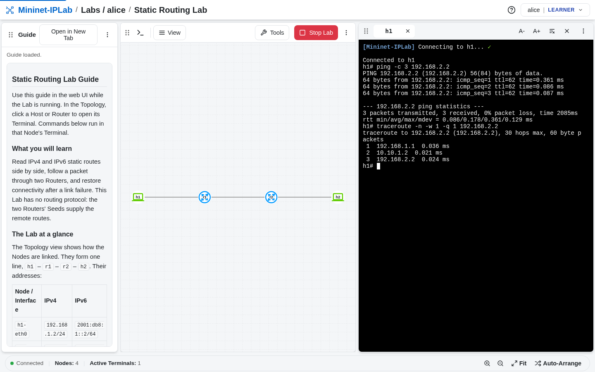
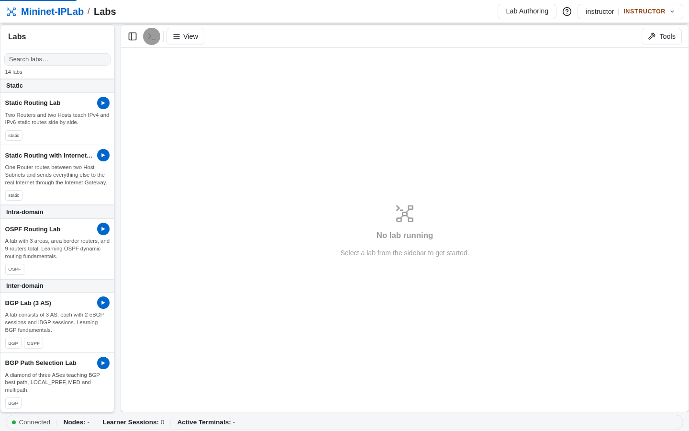

Web UI Mode is the browser surface for the same Lab you run in CLI Mode. It draws the Topology, opens a Terminal on
any Node, shows the Lab Example's Guide, and gives each Service its own panel. It does not create a second Lab or a
different Topology.



## Add it to a Lab

Nothing changes in `build_network()`. Pass the runner's arguments through to `run_lab()`:

```python
args = parse_lab_args('My Lab')
run_lab(
    build_network(),
    enable_web=args.enable_web,
    web_host=args.web_host,
    web_port=args.web_port,
    log_level=args.log_level,
)
```

Then start one Lab Example with the web server, or start the standalone server and choose a Lab in the browser:

```bash
# One Lab Example
docker compose exec mniplab python3 examples/static-lab.py --enable-web

# Classroom server: no Lab up front, an Instructor starts one from the browser
docker compose exec mniplab python -m mniplab serve
```

Open `http://localhost:8050` and sign in as `admin` with the password printed on the `*** Login username:` line at
startup. It is generated afresh each time unless `MNIPLAB_PASSWORD` is set in `.env`; set your own before anyone else
can reach the server. Both commands listen where `--web-host` / `--web-port` say, else where `MNIPLAB_HOST` /
`MNIPLAB_PORT` say, else on `0.0.0.0:8050`. See [Classroom deployment](/docs/getting-started/classroom/) for
Instructor and Learner logins.

## What is on the page



- **Labs list.** With no Lab running, an Instructor sees every Lab Example from `examples/labs.json` in the left
  sidebar, with search and protocol filters. **▶** starts one. `Ctrl+B` opens and closes the sidebar.
- **Four Panes.** While a Lab runs, the page is the **Guide** at the left, the **Topology** in the centre, and the
  **Terminal** pane over **Packet Analysis** at the right. A Pane with nothing to show takes no room. The Guide comes
  from `examples/guides/<lab-id>.md`. On a phone-width screen the open Panes stack and the page scrolls.
- **Topology.** Routers are blue, Hosts green, switches orange, Speakers purple, and Container Hosts Docker blue. The
  authored Layout from `examples/layouts/<lab-id>.json` places the Nodes; **View → Reset to Authored Layout** puts them
  back after you drag them, and an Instructor can **Save as Authored Layout**.
- **Terminals.** Click a Node to open a Terminal tab inside that Node: `hostname` returns the Node's name and `ps`
  lists only its processes. Each browser Session can hold five Terminals by default, an idle one closes after five
  minutes, and a reloaded page reattaches to its Terminals within that window.
- **Node and Link menus.** Right-click a Node (or press `Shift+F10` on it) for its Terminal,
  [Packet Capture](/docs/features/packet-capture/), [NAT Table](/docs/features/nat/), or Service panel. Click a Link
  to disconnect it, reconnect it, or set its [Link Condition](/docs/features/link-conditions/).
- **Tools.** The **Tools** dialog runs ping, traceroute, iperf, and iperf3 between two Nodes and shows a Router's
  route, OSPF, or BGP table without opening a Terminal.
- **Lab Prompt.** The **Lab Prompt** button in the Topology toolbar, beside **Tools**, opens the network-wide
  `mininet-iplab>` prompt. Only an Instructor sees it. See [Lab Prompt](/docs/features/lab-prompt/).
- **Instructor tools on `serve`.** The header's **Lab Authoring** link opens [Lab Authoring](/docs/build-labs/lab-authoring/),
  and **Server settings** in the account menu changes Terminal, Session, and Lab limits and adds Learner logins while
  the class runs. See [Classroom deployment](/docs/getting-started/classroom/).

### Service panels

A Node that offers a Service carries a badge above it in the Topology. Select the badge to open that Service's panel.
What a Learner edits in a panel is Exercise Configuration: it applies to the running daemon at once and is discarded
when the Lab stops.

| Badge | Panel | Feature page |
| --- | --- | --- |
| `DHCP`, `DHCPv6` | Address Pools, Reservations, and the Active Leases table | [DHCP](/docs/features/dhcp/) |
| `DHCP RELAY` | Covered Subnets, the upstream Service, and forwarded requests | [DHCP Relay](/docs/features/dhcp-relay/) |
| `DNS`, `DNS · SECONDARY` | Zone and Record editor, replication state, DNSSEC keys, and live query counters | [Authoritative DNS](/docs/features/dns/) |
| `RESOLVER` | Cache Inspector and Access Control | [Recursive Resolver](/docs/features/dns-resolver/) |
| `RPKI CA`, `Validator` | Hosted CAs with their ROAs and ASPAs; the VRPs and ASPAs served to Routers | [RPKI and Secure BGP](/docs/features/rpki/) |
| Speaker menu | Neighbors, announced routes, and the announce and generate forms | [ExaBGP](/docs/features/exabgp/) |
| Switch (click it) | Port modes and VLAN IDs, the MAC table, and spanning tree | [VLANs and switches](/docs/features/vlans/) |

## Verify it

Start `static-lab` with `--enable-web`, sign in, and click `h1`. In its Terminal run:

```bash
ping -c 3 192.168.2.2
traceroute -n 192.168.2.2
```

The replies and the three hops `192.168.1.1 → 10.10.1.2 → 192.168.2.2` show the same path CLI Mode would. The core
[Web UI guide](https://github.com/mininet-iplab/mininet-iplab/blob/v0.1.0/docs/web-ui.md) covers every setting and
the REST API behind the page.
