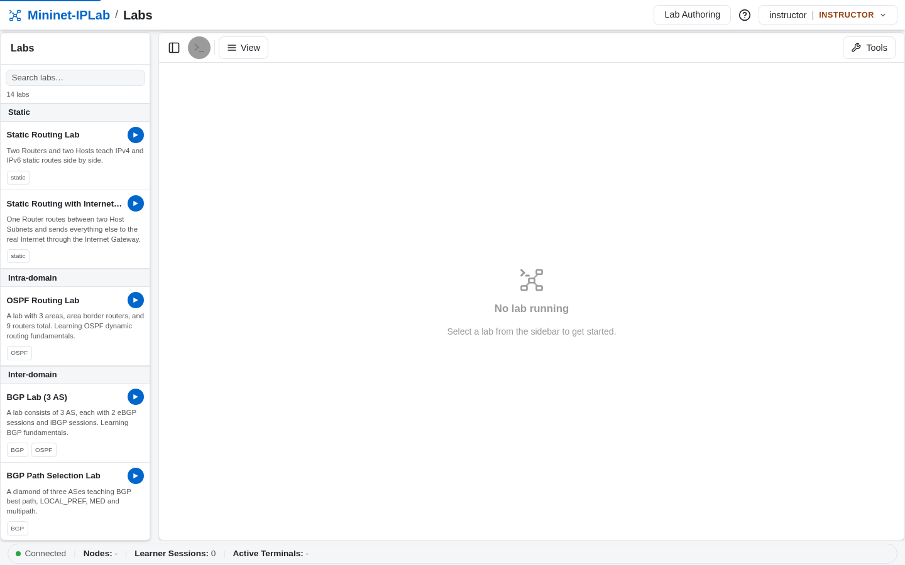

<p class="doc-lede">Use classroom deployment when an Instructor starts one Lab in a browser and multiple Learners join
that same running Lab.</p>

The server starts with no Lab loaded:

1. an **Instructor** signs in and chooses a Lab from the sidebar;
2. the server builds and starts that Lab from `examples/labs.json`;
3. **Learners** sign in, open the running Topology, and use the available Guides and Terminals.

This is **Single-Lab Mode**, the default: one Lab runs at a time and every login shares it, which suits a class that
moves through the exercise together. Stopping it closes the active terminal sessions. For a class that works at its
own pace, [Multi-Lab Mode](/docs/features/multi-lab/) gives each Group a Lab of its own.

:::caution[Learners are trusted]
A Terminal is a root shell on the lab machine, so a Learner who looks can read `.env` and `accounts.json`, every
password included. Logins keep Groups apart; they do not keep Learners out of the Instructor's account. The container
also runs `privileged`, which gives it near-host access. Run a class only with Learners you would trust with the
machine, on a machine set aside for the lab.
:::

## 1. Prepare the core checkout

Complete the [Prerequisites](/docs/getting-started/prerequisites/) first. From the core repository directory, build and
start the Compose container:

```bash
docker compose build
docker compose up -d
```

The Compose file mounts the repository at `/mininet-iplab`, so the standalone server can see the executable examples,
`examples/labs.json`, layouts, and in-app Guides.

## 2. Create the `.env` file

Create `.env` beside `docker-compose.yml`, not in the documentation-site repository:

```bash
cp .env.example .env
```

Edit `.env` before sharing the server. Do not commit it: it contains classroom passwords.

For a small classroom served over HTTP on port `8050`, use a file like this and replace every example password:

```dotenv
MNIPLAB_HOST=0.0.0.0
MNIPLAB_PORT=8050

# Use production checks for a shared deployment.
MNIPLAB_ENVIRONMENT=production
MNIPLAB_CORS_ORIGINS=["http://lab.example.edu:8050"]
MNIPLAB_USE_SECURE_COOKIES=false

# MNIPLAB_USERS overrides the single-user settings below.
MNIPLAB_USERS=teacher:InstructorPass1:instructor,student01:LearnerPass1:learner,student02:LearnerPass2:learner

# Keep these only as a fallback for local testing when MNIPLAB_USERS is empty.
MNIPLAB_USERNAME=teacher
MNIPLAB_PASSWORD=InstructorPass1

# Operational capacity, not a security boundary.
MNIPLAB_TERMINAL_PER_SESSION_CAP=5
MNIPLAB_TERMINAL_GLOBAL_CAP=100
MNIPLAB_TERMINAL_IDLE_TIMEOUT=300
MNIPLAB_SESSION_IDLE_TIMEOUT=9000
MNIPLAB_SESSION_PER_USER_CAP=0
```

<details>
<summary>What the important settings do</summary>

| Setting | Use |
| --- | --- |
| `MNIPLAB_USERS` | Comma-separated `username:password:role` accounts. Roles are `instructor` and `learner`. |
| `MNIPLAB_ENVIRONMENT=production` | Enables stricter configuration checks. Do not leave the default password in production. |
| `MNIPLAB_CORS_ORIGINS` | Restricts browser origins when production mode is enabled. Use the real classroom URL. |
| `MNIPLAB_USE_SECURE_COOKIES` | Set `true` only when the server is reached through HTTPS. Keep it `false` for plain HTTP. |
| `MNIPLAB_TERMINAL_PER_SESSION_CAP` | Maximum open Terminals for one browser Session. |
| `MNIPLAB_TERMINAL_GLOBAL_CAP` | Maximum open Terminals across the host. |
| `MNIPLAB_SESSION_PER_USER_CAP` | Maximum Sessions per account; leave it `0` when one account is intentionally shared by a class. |

`MNIPLAB_USERS` takes precedence over `MNIPLAB_USERNAME` and `MNIPLAB_PASSWORD`. Every password must be at least eight
characters and contain at least one letter and one number. Without `MNIPLAB_PASSWORD` or `MNIPLAB_USERS`, the server
generates a new password at every start.

The server reads `.env` from the current working directory when it starts; export `MNIPLAB_ENV_FILE=<path>` to read
another file. Shell environment variables take precedence over values in the file. The server prints the `.env`
account names, passwords, and roles at startup, so protect the terminal and logs used to run it. After changing
`.env`, restart `python -m mniplab serve`.

The server speaks plain HTTP, so passwords cross the network unencrypted. Keep it on the classroom network or a VPN,
or put a TLS reverse proxy in front and set `MNIPLAB_USE_SECURE_COOKIES=true`.

</details>

## 3. Start the classroom server

Run the standalone server inside the running container:

```bash
docker compose exec mniplab python -m mniplab serve --web-host 0.0.0.0 --web-port 8050
```

Leave this command running. The `--web-host` and `--web-port` flags choose where this `serve` process listens; Docker
Compose publishes only port `8050`, so another port also needs the `ports:` mapping in `docker-compose.yml` changed. The server logs to `/tmp/mniplab-web.log` inside the container.

For a background process, use:

```bash
docker compose exec -d mniplab python -m mniplab serve --web-host 0.0.0.0 --web-port 8050
```

Open `http://<server-address>:8050` from the Instructor and Learner devices. Replace `<server-address>` with the
Linux host's LAN address or classroom DNS name; do not ask Learners to use their own `localhost`.

## 4. Run a Lab with the class

### Instructor

1. Sign in with the account whose role is `instructor`.
2. Choose a Lab from the sidebar. The list comes from `examples/labs.json`.
3. Wait for the topology and Guide to load.
4. Share the same server address with the class.
5. Use **Stop Lab** when the exercise is finished.



The Instructor can start and stop Labs, open Terminals, save the Web UI Layout, and see active Sessions. A Lab Example
must be registered in `examples/labs.json` before it appears in the list:

```bash
python3 util/gen_labs_json.py examples/my-lab.py
```

### Learners

1. Sign in with a `learner` account after the Instructor starts the Lab.
2. Open the Topology and the Guide from the sidebar.
3. Select a Node to open its in-browser Terminal.
4. Perform only the exercise actions described by the Guide.

If no Lab is running, Learners see a waiting state. They cannot start or stop a Lab.

To give each Group its own Lab instead of one shared Lab, set `MNIPLAB_LAB_MODE=multi`; see
[Multi-Lab Mode](/docs/features/multi-lab/).

### Server settings

On `serve`, **Server settings** in the Instructor's account menu changes the class while it runs, without a restart:

- **Limits** changes Terminals per Session, Terminals on the whole server, the idle Terminal timeout, the idle Session
  timeout, Sessions per login, and, in Multi-Lab Mode, Labs alive at once. A save applies at once; lowering a cap
  closes nothing already open. Saved Limits are kept in `settings.json`, and `.env` stays the baseline: empty a field
  and save to return to it. A Limit exported in the server's environment wins and shows as fixed.
- **Accounts** lists every login. **Add login** creates a Learner with a generated password such as `crane-ruby-4827`
  that signs in straight away; **Reset password…** and **Remove…** act on page-added logins only. They are kept in
  `accounts.json`, readable by the server's owner only, and survive a restart. Logins set in `.env` are changed only
  there.

Session and Terminal limits are operational hygiene, not security boundaries. The per-login Session cap is off by
default; turning it on while a class shares one login locks the class out.

## 5. Shut down cleanly

Stop the Lab from the Instructor UI first. Then stop the server with `Ctrl+C` in the terminal running
`python -m mniplab serve`.
When the server was started in the background, stop the container after the exercise:

```bash
docker compose down
```

After an interrupted run, clean the runtime before starting another classroom session:

```bash
docker compose exec mniplab python -m mniplab cleanup
docker compose down --remove-orphans
```

Cleanup stops every Lab on the host, so never run it while `serve` is up.

## Troubleshooting

### Learners cannot connect

Check that:

- the server is bound to `0.0.0.0`;
- port `8050` is published and allowed by the host firewall;
- Learners are opening `http://<server-address>:8050`, not `http://localhost:8050`; and
- `MNIPLAB_CORS_ORIGINS` contains the actual classroom origin when production mode is enabled.

### The Lab list is empty

`python -m mniplab serve` reads `examples/labs.json` from the core checkout. Run the manifest check from that checkout:

```bash
python3 util/gen_labs_json.py --check
```

### Credentials did not change

Stop and restart `python -m mniplab serve`. Confirm that `.env` is in the core repository directory mounted at `/mininet-iplab`,
and that a shell variable is not overriding it. When `MNIPLAB_USERS` is set, its accounts replace the single-user
`MNIPLAB_USERNAME` and `MNIPLAB_PASSWORD` pair.

The core repository's source-backed references are [`mniplab serve`](https://github.com/mininet-iplab/mininet-iplab/blob/v0.1.0/mniplab/__main__.py),
the [`.env.example`](https://github.com/mininet-iplab/mininet-iplab/blob/v0.1.0/.env.example),
and the [Web UI guide](https://github.com/mininet-iplab/mininet-iplab/blob/v0.1.0/docs/web-ui.md).
