Mininet-IPLab `v0.1.0` ships 14 Lab Examples, each with a step-by-step Guide. Each one below is shown running in
[Web UI Mode](/docs/features/web-ui/) with its authored Layout and its Guide open. Start any of them from the Web UI's
Lab Catalog, or from the core repository in CLI Mode:

```bash
# CLI Mode
docker compose exec mniplab python3 examples/<lab-id>.py

# Web UI Mode
docker compose exec mniplab python3 examples/<lab-id>.py --enable-web
```

In Web UI Mode the Guide opens in the Guide pane while the Lab runs; the **Guide** link below opens the same text in the
core repository. **Persistent Config** Lab Examples keep Router configuration in `frr-config/`; see
[Persistent Config](/docs/build-labs/persistent-config/). An Instructor on the classroom server can also copy any of
them into [Lab Authoring](/docs/build-labs/lab-authoring/) as the starting point for a new one.

## Routing

Start here: static routes, then an interior protocol, then BGP between Autonomous Systems and its defenses.

### Static Routing Lab

Two Routers and two Hosts teach IPv4 and IPv6 static routes side by side.

`static-lab` · static · 4 Nodes · Persistent Config · [source](https://github.com/mininet-iplab/mininet-iplab/blob/v0.1.0/examples/static-lab.py) · [Guide](https://github.com/mininet-iplab/mininet-iplab/blob/v0.1.0/examples/guides/static-lab.md) · [feature page](/docs/features/static-routing/)

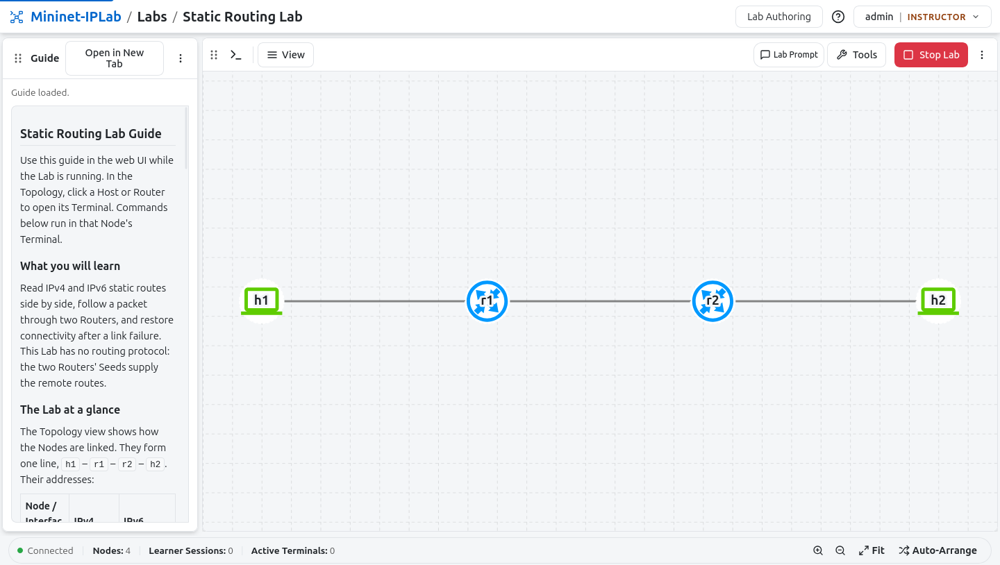

### Static Routing with Internet Access

One Router routes between two Host Subnets and sends everything else to the real Internet through the Internet Gateway.

`static-lab-nat` · static · 4 Nodes · [source](https://github.com/mininet-iplab/mininet-iplab/blob/v0.1.0/examples/static-lab-nat.py) · [Guide](https://github.com/mininet-iplab/mininet-iplab/blob/v0.1.0/examples/guides/static-lab-nat.md) · [feature page](/docs/features/nat/)

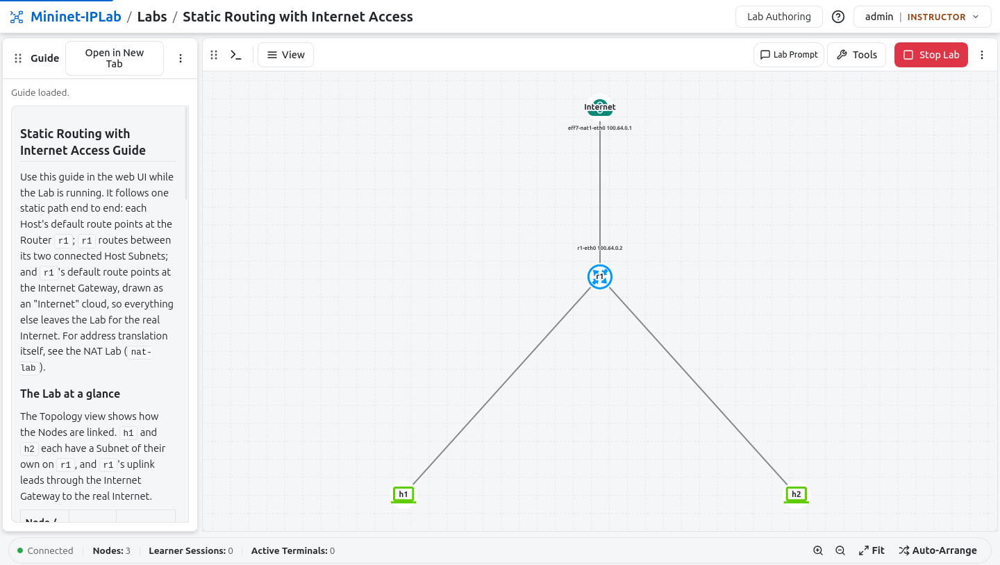

### OSPF Routing Lab

A lab with 3 areas, area border routers, and 9 routers total. Learning OSPF dynamic routing fundamentals.

`ospf-lab` · OSPF · 18 Nodes · Persistent Config · [source](https://github.com/mininet-iplab/mininet-iplab/blob/v0.1.0/examples/ospf-lab.py) · [Guide](https://github.com/mininet-iplab/mininet-iplab/blob/v0.1.0/examples/guides/ospf-lab.md) · [feature page](/docs/features/ospf/)

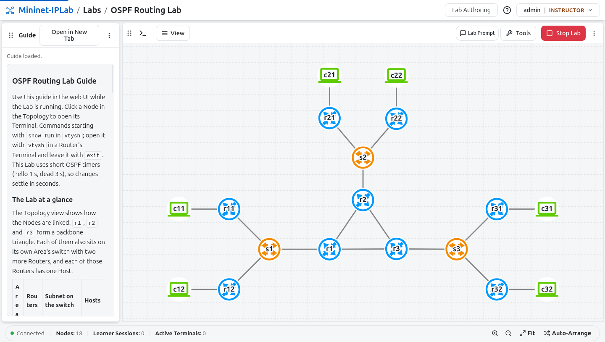

### BGP Lab (3 AS)

A lab consists of 3 AS, each with 2 eBGP sessions and iBGP sessions. Learning BGP fundamentals.

`bgp-lab` · BGP, OSPF · 15 Nodes · Persistent Config · [source](https://github.com/mininet-iplab/mininet-iplab/blob/v0.1.0/examples/bgp-lab.py) · [Guide](https://github.com/mininet-iplab/mininet-iplab/blob/v0.1.0/examples/guides/bgp-lab.md) · [feature page](/docs/features/bgp/)

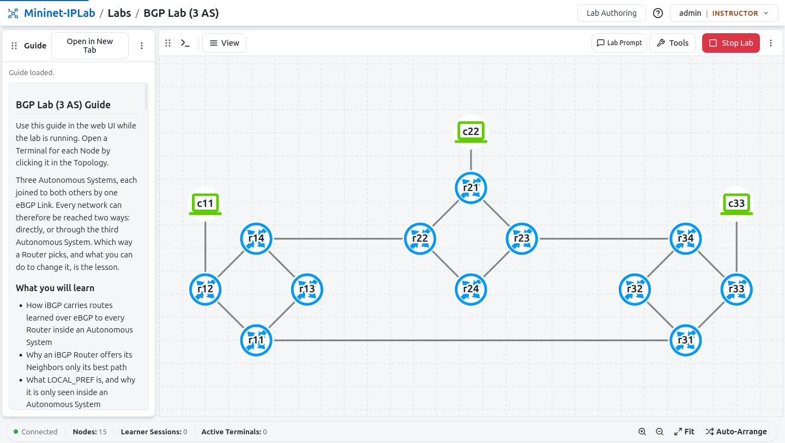

### BGP Path Selection Lab

A diamond of three ASes teaching BGP best path, LOCAL_PREF, MED and multipath.

`bgp-path-lab` · BGP · 8 Nodes · Persistent Config · [source](https://github.com/mininet-iplab/mininet-iplab/blob/v0.1.0/examples/bgp-path-lab.py) · [Guide](https://github.com/mininet-iplab/mininet-iplab/blob/v0.1.0/examples/guides/bgp-path-lab.md) · [feature page](/docs/features/bgp/)

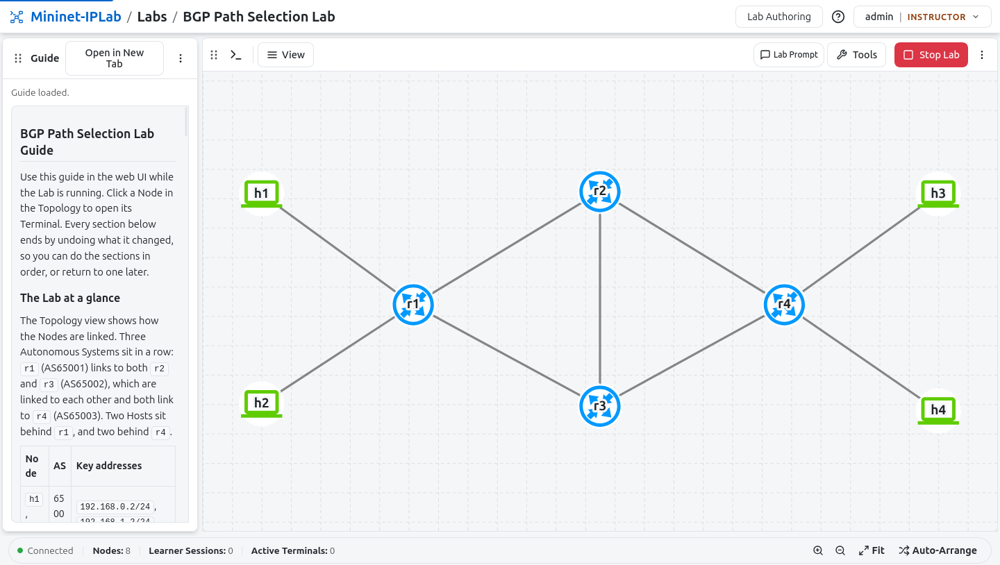

### BGP 2 ISP Lab

A lab with 2 ISPs exchange its customer networks. Internet is emulated via NAT at each ISP's node.

`bgp-isp-lab` · BGP, OSPF, ExaBGP · 16 Nodes · Persistent Config · [source](https://github.com/mininet-iplab/mininet-iplab/blob/v0.1.0/examples/bgp-isp-lab.py) · [Guide](https://github.com/mininet-iplab/mininet-iplab/blob/v0.1.0/examples/guides/bgp-isp-lab.md) · [feature page](/docs/features/exabgp/)

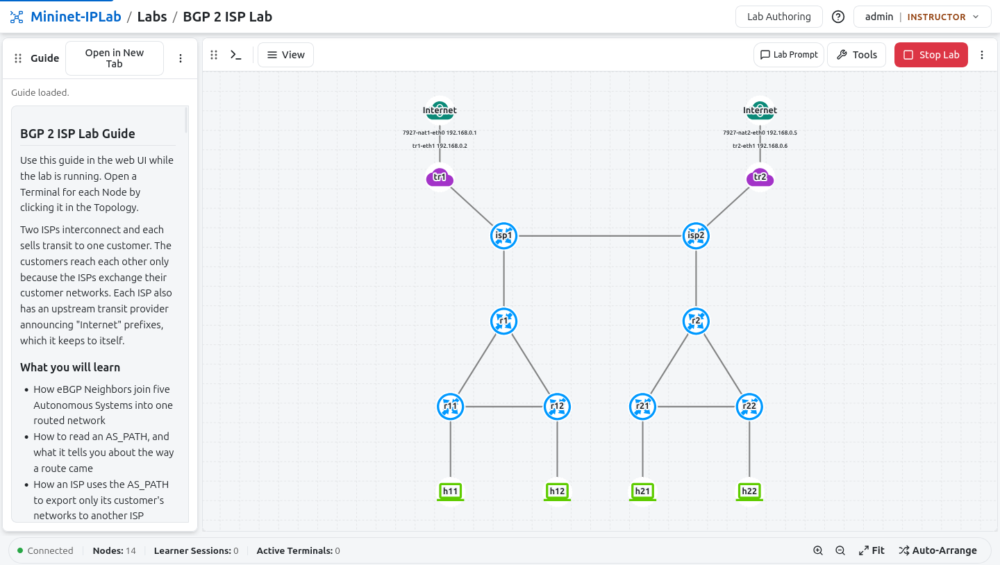

### BGP ISP / IXP Lab

A lab with ISP topology and an internet exchange point (IXP), route servers, and tier-ISP (ExaBGP speakers).

`bgp-ispixp-lab` · BGP, ExaBGP · 21 Nodes · Persistent Config · [source](https://github.com/mininet-iplab/mininet-iplab/blob/v0.1.0/examples/bgp-ispixp-lab.py) · [Guide](https://github.com/mininet-iplab/mininet-iplab/blob/v0.1.0/examples/guides/bgp-ispixp-lab.md) · [feature page](/docs/features/exabgp/)

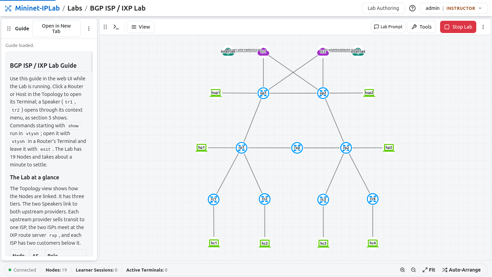

### BGP Data Center Lab

A lab with data center fabric and BGP route servers in a leaf-spine topology.

`bgp-dc-lab` · BGP · 10 Nodes · Persistent Config · [source](https://github.com/mininet-iplab/mininet-iplab/blob/v0.1.0/examples/bgp-dc-lab.py) · [Guide](https://github.com/mininet-iplab/mininet-iplab/blob/v0.1.0/examples/guides/bgp-dc-lab.md) · [feature page](/docs/features/bgp/)

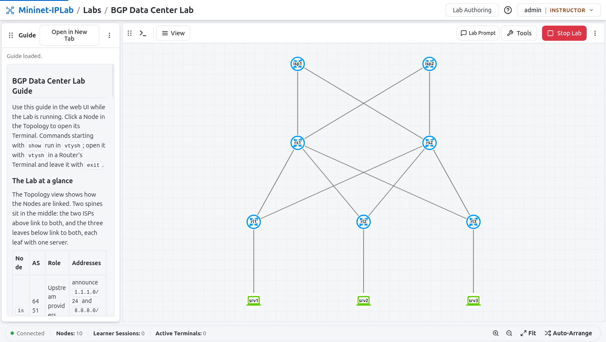

### Secure BGP Lab

An origin hijack, a forged-origin sub-prefix through a loose maxLength and a route leak, each seen first and then stopped with Route Origin Validation (an RPKI CA and a Validator) and BGP Roles.

`secure-bgp-lab` · BGP, ExaBGP, RPKI · 8 Nodes · Persistent Config · [source](https://github.com/mininet-iplab/mininet-iplab/blob/v0.1.0/examples/secure-bgp-lab.py) · [Guide](https://github.com/mininet-iplab/mininet-iplab/blob/v0.1.0/examples/guides/secure-bgp-lab.md) · [feature page](/docs/features/rpki/)

## Network Services

Real DHCP and DNS software on Lab Nodes: Kea, Knot DNS, and Unbound.

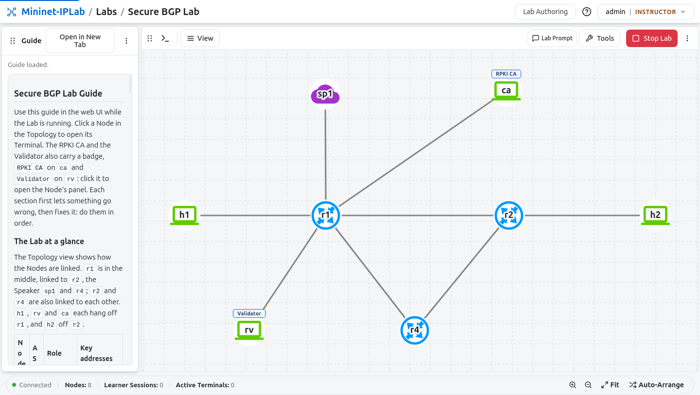

### DHCP Lab

One central DHCP Service with direct, relayed, IPv4-only and IPv6-only Subnets, the three Router Advertisement outcomes, and a rogue server to start and stop.

`dhcp-lab` · DHCP, DHCPv6, DHCP Relay · 10 Nodes · [source](https://github.com/mininet-iplab/mininet-iplab/blob/v0.1.0/examples/dhcp-lab.py) · [Guide](https://github.com/mininet-iplab/mininet-iplab/blob/v0.1.0/examples/guides/dhcp-lab.md) · [feature page](/docs/features/dhcp/)

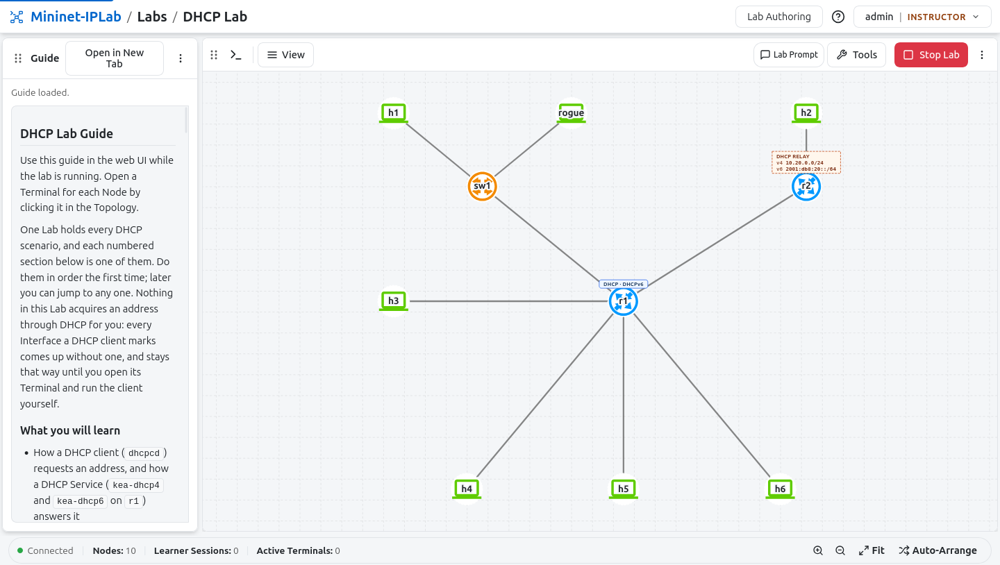

### DNS Lab

A Root, a TLD, a Primary and a Secondary nameserver, a Recursive Caching Resolver and a client, each on its own Subnet, so a lookup, a Zone Transfer, a cache and an SOA expiry are all observable.

`dns-lab` · DNS, Resolver · 7 Nodes · [source](https://github.com/mininet-iplab/mininet-iplab/blob/v0.1.0/examples/dns-lab.py) · [Guide](https://github.com/mininet-iplab/mininet-iplab/blob/v0.1.0/examples/guides/dns-lab.md) · [feature page](/docs/features/dns/)

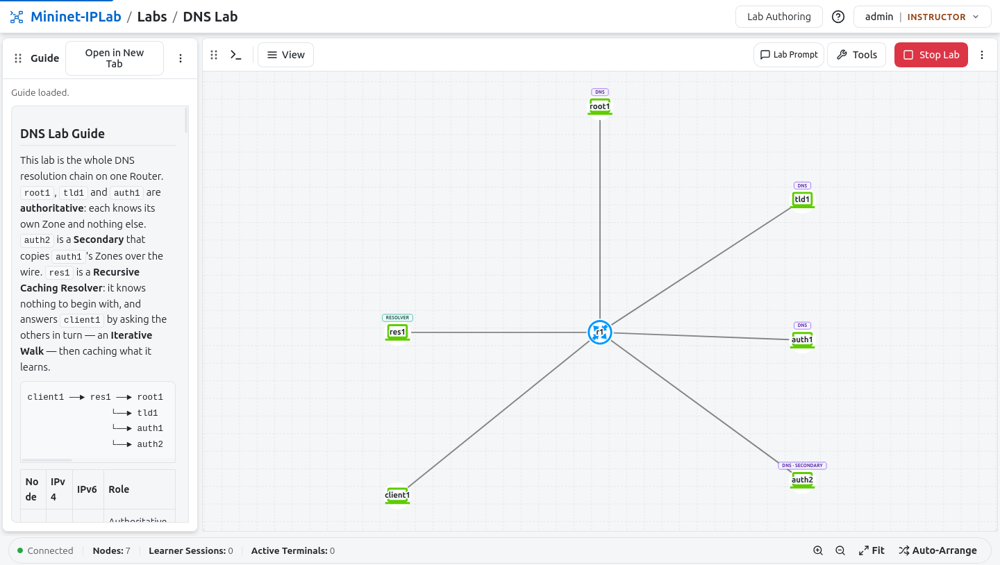

### DNSSEC Flagship Lab

A signed Root -> TLD -> Authoritative hierarchy and a validating Resolver, so the chain of trust, the AD flag, a broken DS delegation, authenticated denial of existence, and a ZSK rollover are all observable.

`dnssec-lab` · DNS, DNSSEC, Resolver · 7 Nodes · [source](https://github.com/mininet-iplab/mininet-iplab/blob/v0.1.0/examples/dnssec-lab.py) · [Guide](https://github.com/mininet-iplab/mininet-iplab/blob/v0.1.0/examples/guides/dnssec-lab.md) · [feature page](/docs/features/dnssec/)

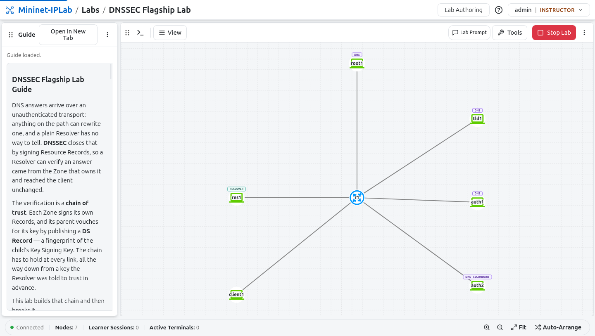

## Switching and NAT

Layer 2 segmentation with spanning tree, and the address translation a home Router performs.

### VLAN & Inter-VLAN Routing Lab

Two VLANs across three Switches with 802.1Q trunks, router-on-a-stick routing, MAC learning, and an RSTP triangle that fails over.

`vlan-lab` · VLAN, RSTP, static · 8 Nodes · [source](https://github.com/mininet-iplab/mininet-iplab/blob/v0.1.0/examples/vlan-lab.py) · [Guide](https://github.com/mininet-iplab/mininet-iplab/blob/v0.1.0/examples/guides/vlan-lab.md) · [feature page](/docs/features/vlans/)

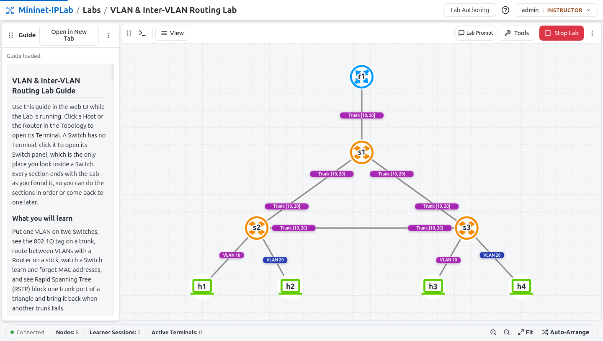

### NAT Lab

A home network behind a NAT Router: PAT, a port forward and a static 1:1 mapping, with an ISP on documentation ranges.

`nat-lab` · static · 9 Nodes · Persistent Config · [source](https://github.com/mininet-iplab/mininet-iplab/blob/v0.1.0/examples/nat-lab.py) · [Guide](https://github.com/mininet-iplab/mininet-iplab/blob/v0.1.0/examples/guides/nat-lab.md) · [feature page](/docs/features/nat/)

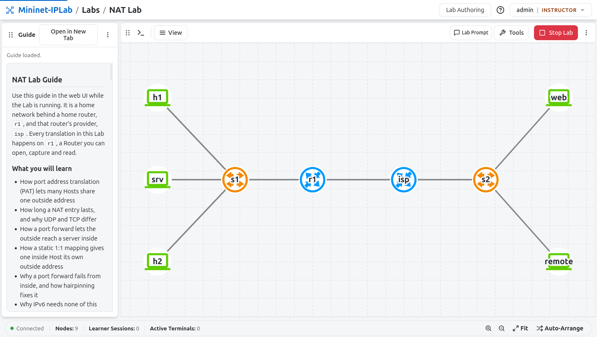

